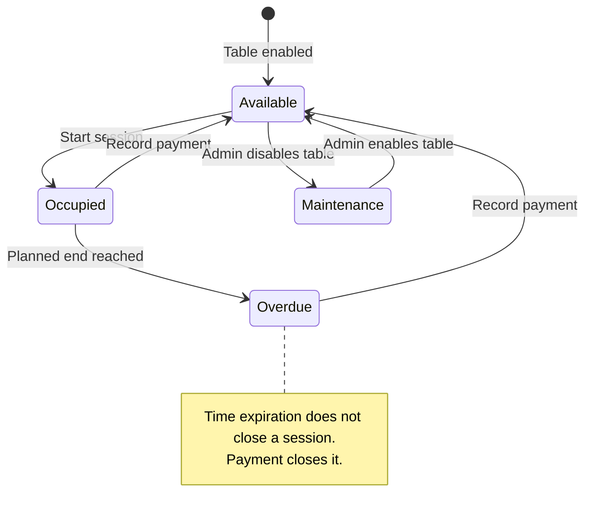
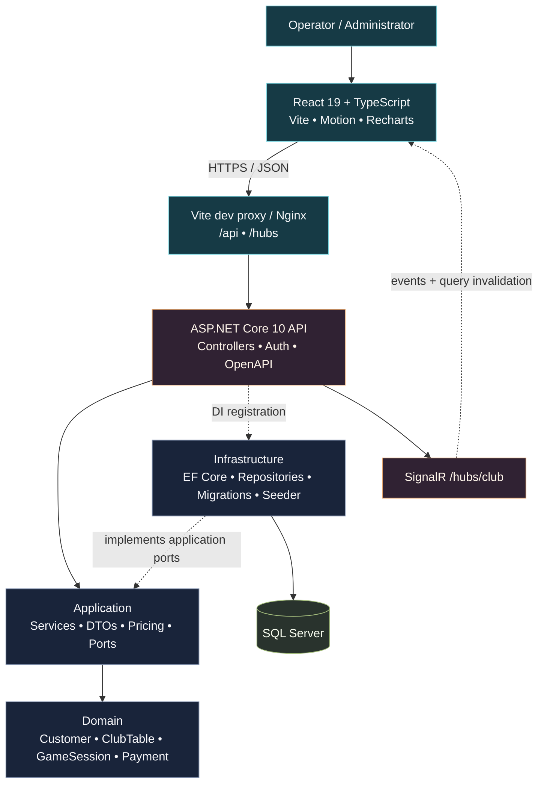
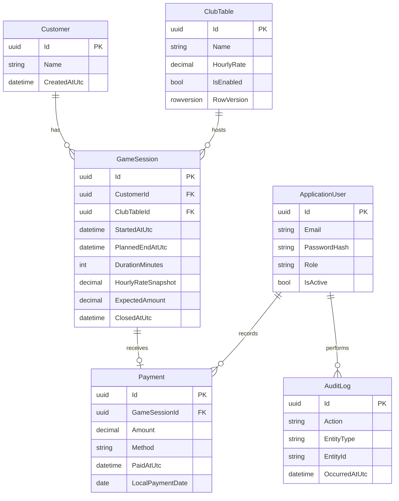
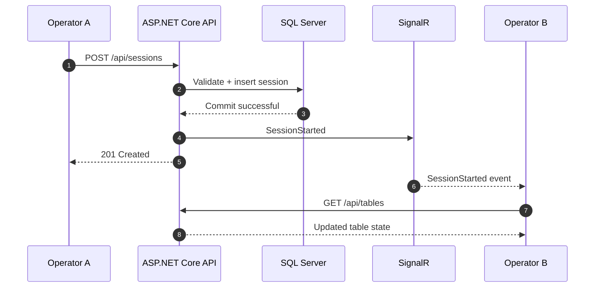

<p align="center">
  
</p>

<h1 align="center">PLAYDESK · RAGNAROK EDITION</h1>

<p align="center">
  <strong>Real-time gaming club management, built with production-oriented engineering practices.</strong><br/>
  <sub>Oyun masalarını, sessiyaları, müştəriləri, ödənişləri və gəliri bir idarəetmə panelində birləşdirən full-stack platforma.</sub>
</p>

<p align="center">
  <a href="https://github.com/EldarAslan-dev/PlayDesk/actions/workflows/ci.yml"></a>
  
  
  
  
  
  
</p>

<p align="center">
  <a href="#overview">Overview</a> ·
  <a href="#experience">UI Experience</a> ·
  <a href="#workflow">Business Flow</a> ·
  <a href="#architecture">Architecture</a> ·
  <a href="#api-reference">API</a> ·
  <a href="#quick-start">Quick Start</a> ·
  <a href="#quality--security">Quality & Security</a>
</p>

> [!IMPORTANT]
> PlayDesk **portfolio/reference implementation** layihəsidir. Real bank kartı emalı, fiskal kassa, vergi uçotu və ya sertifikatlı POS sistemi deyil. `Card` əməliyyatı yalnız operatorun artıq qəbul etdiyi ödənişi qeyd edir. Animasiya qrafiklərindəki rəqəmlər **nümunə məlumatlardır**.

---

## Overview

### Problem → Solution

Oyun klubunda eyni vaxtda bir neçə operator masaları idarə edərkən üç problem yaranır: **iki dəfə masa ayırmaq**, **sessiya bağlanmadan masanı boş hesab etmək** və **ödənişlə hesabatın uyğunsuzluğu**.

**PlayDesk** bu axını əlaqəli biznes qaydaları ilə idarə edir:

- **Customer management:** yeni müştəri qeydiyyatı, ad üzrə axtarış.
- **Table availability:** `Available`, `Occupied`, `Overdue`, `Maintenance` vəziyyətləri.
- **Game sessions:** 30 dəqiqəlik addımlarla sessiya açılması, planlaşdırılan bitmə vaxtı və canlı taymer.
- **Payment processing:** server tərəfindən hesablanan məbləğ, `Cash`/`Card` qeydiyyatı və atomik sessiya bağlanması.
- **Revenue analytics:** seçilmiş tarix və tarix aralığı üzrə ödəniş sayı, gəlir, günlük qrafiklər.
- **Real-time updates:** SignalR ilə bir operatorun dəyişikliklərinin digər ekranlarda əks olunması.
- **Administration:** rollar, istifadəçi aktivliyi, masa tarifləri və audit tarixçəsi.

### Product capabilities

| Operator workflow | Admin & analytics | Engineering |
|:--|:--|:--|
| Müştəri yarat / axtar | Masa qiymətlərini yenilə | ASP.NET Core Web API |
| Boş masa seç və sessiya başlat | Masanı istifadədən çıxart | SQL Server + EF Core |
| Taymer və gecikən sessiyalara bax | İstifadəçi/rol idarəetməsi | Cookie auth + antiforgery |
| Ödənişi qeyd et, masanı boşalt | Günlük və tarix aralığı hesabatları | DB uniqueness + concurrency |
| Canlı yenilənmələri izlə | Audit log | SignalR + TanStack Query |

---

## Experience

### A gaming dashboard, not a generic admin panel

**Ragnarok Edition** — orijinal dark-fantasy vizual kimlik, metal/ember/ice rəngləri, cinematic login və interaktiv idarəetmə komponentləri. Dizayn başqa oyunun rəsmi loqosu və ya artwork-unun kopyası deyil.

<p align="center">
  
  <br/><sub>Layihənin mövcud frontend asset-i: Nordic Arena.</sub>
</p>

| UI layer | Implementation |
|:--|:--|
| Layout | React 19 + React Router 7 |
| Styling | Tailwind CSS 4 + custom `styles.premium.css` |
| Motion | Motion for React — route, hover, modal, sidebar transitions |
| Data | TanStack Query — request caching, invalidation & refetch |
| Charts | Recharts |
| Icons | Lucide React |
| Accessibility | Responsive layout və `prefers-reduced-motion` dəstəyi |

**Əsas ekranlar:** Dashboard · Tables · Sessions · Customers · Reports · Settings (Admin). Login və çıxış ayrıca autentifikasiya axınıdır.

> [!TIP]
> Theme-i dəyişmək üçün `src/frontend/playdesk-web/src/styles.premium.css` faylındakı rəng dəyişənlərinə və komponent stillərinə bax. Backend-ə toxunmadan UI dəyişdirilə bilər.

---

## Workflow

### One session, one consistent transaction

<p align="center">
  
</p>

**Nümunə:** `Table 02` saatlıq **12 AZN**, seçilən müddət **90 dəqiqə** → server məbləği **18.00 AZN** hesablayır.

```text
Customer registered
    └─> Available table selected
          └─> Session created (startedAtUtc + duration)
                └─> Table becomes Occupied / Overdue
                      └─> Operator records payment
                            ├─> Payment saved
                            ├─> Session closed
                            ├─> Table becomes Available
                            └─> Revenue attributed to Baku payment date
```

### Session state machine



### Pricing & time semantics

```text
ExpectedAmount = HourlyRateSnapshot × DurationMinutes / 60
12.00 AZN      × 90 minutes / 60    = 18.00 AZN
```

- Müddət `30–1440` dəqiqə aralığında və `30` dəqiqənin qatlarında olmalıdır.
- Tarif sessiya açılan anda **snapshot** kimi saxlanılır. Sonradan tarif dəyişsə də, əvvəlki sessiyanın məbləği dəyişmir.
- Vaxtlar UTC ilə saxlanılır; gəlir ödənişin **Asia/Baku** təqvim gününə görə hesablanır.
- Planlaşdırılan bitmə vaxtının keçməsi **avtomatik ödəniş və ya bağlanma deyil**.
- Bir sessiyaya yalnız **bir ödəniş** qeydə alınır; DB unikal məhdudiyyəti təkrar qeydi bloklayır.

### Revenue preview

<p align="center">
  
  <br/><sub>Bu animasiyalı SVG nümunə qrafikdir; real və ya canlı klub gəlirini göstərmir. Tətbiq faktiki göstəriciləri SQL Server-dən alır.</sub>
</p>

---

## Architecture

**Modular layered monolith.** İlk versiyada ayrı mikroservislərə və message broker-ə ehtiyac yoxdur. API, Application, Domain və Infrastructure arasında aydın məsuliyyət bölgüsü mövcuddur.



### Repository layout

```text
PlayDesk/
├── PlayDesk.sln
├── Directory.Build.props
├── global.json
├── docker-compose.yml
├── .env.example
├── .github/workflows/ci.yml
│
├── src/
│   ├── backend/
│   │   ├── PlayDesk.API/              # HTTP, auth, SignalR, DI, Scalar
│   │   ├── PlayDesk.Application/      # Business rules, DTOs, service contracts
│   │   ├── PlayDesk.Domain/           # Domain entities, roles, payment method
│   │   └── PlayDesk.Infrastructure/   # EF Core, repositories, migrations, seeding
│   └── frontend/
│       └── playdesk-web/             # React + TypeScript + Vite
│           ├── public/assets/
│           └── src/
│               ├── components/
│               ├── lib/
│               ├── pages/
│               └── styles.premium.css
│
├── tests/PlayDesk.UnitTests/
├── docs/
│   ├── ARCHITECTURE.md
│   ├── ERD.md
│   ├── TESTING.md
│   └── assets/                     # Animated diagrams for this README
└── examples/requests.http
```

### Data model



**Critical database constraints:**

- `GameSession.ClubTableId` üçün `ClosedAtUtc IS NULL` şərtli **unique filtered index** — hər masada ən çox bir aktiv sessiya.
- `Payment.GameSessionId` üçün **unique index** — eyni sessiyaya iki ödəniş yazıla bilməz.
- EF Core `rowversion` tokenləri — concurrent yenilənmələrdə konfliktin aşkarlanması.
- Ödəniş, sessiyanın bağlanması və audit qeydi bir `SaveChangesAsync()` tranzaksiyasında saxlanılır.

Ətraflı: [Architecture](docs/ARCHITECTURE.md) · [ERD](docs/ERD.md) · [Testing](docs/TESTING.md)

---

## Real-time synchronization



**Consistency model:** Database **source of truth** olaraq qalır. SignalR hadisələri commit-dən sonra göndərilir və TanStack Query cache-ni invalidasiya edir. Bağlantı bərpa olunanda və müəyyən hallarda təkrar sorğu ilə məlumatlar yenilənir. Hadisələrin mütləq və tək dəfə çatdırılmasına zəmanət verilmir.

| Event | Frontend effect |
|:--|:--|
| `SessionStarted` | Aktiv masaları və sessiyaları yenilə |
| `SessionClosed` | Boş masa vəziyyətini yenilə |
| `PaymentRecorded` | Ödəniş, dashboard və gəlir məlumatlarını yenilə |
| `TableUpdated` | Tarif/status konfiqurasiyasını yenilə |

---

## API Reference

**Development URL:** [`http://localhost:5074/scalar/v1`](http://localhost:5074/scalar/v1) — API işləyən lokal maşında Scalar sənədləşməsi.

| Method | Endpoint | Description | Access |
|:--|:--|:--|:--|
| `GET` | `/api/auth/csrf` | CSRF token al | Public |
| `POST` | `/api/auth/login` | Cookie ilə giriş | Public + CSRF |
| `POST` | `/api/auth/logout` | Sessiyadan çıxış | Authenticated |
| `GET` | `/api/auth/me` | Cari istifadəçi | Authenticated |
| `POST` | `/api/customers` | Müştəri yarat | Authenticated |
| `GET` | `/api/customers?search=` | Müştəri axtar | Authenticated |
| `GET` | `/api/customers/{id}` | Müştəri detalı | Authenticated |
| `GET` | `/api/tables?isAvailable=true` | Boş masaları göstər | Authenticated |
| `PATCH` | `/api/tables/{id}/rate` | Saatlıq tarif yenilə | Admin |
| `PATCH` | `/api/tables/{id}/availability` | Masanı aktiv/deaktiv et | Admin |
| `POST` | `/api/sessions` | Sessiya aç | Authenticated |
| `GET` | `/api/sessions?activeOnly=true` | Aktiv sessiyalar | Authenticated |
| `GET` | `/api/sessions/{id}` | Sessiya məlumatı | Authenticated |
| `POST` | `/api/sessions/{id}/payment` | Ödənişi təsdiqlə | Authenticated |
| `GET` | `/api/reports/daily-revenue?date=2026-11-15` | Günlük gəlir | Authenticated |
| `GET` | `/api/reports/revenue?from=2026-11-01&to=2026-11-15` | Tarix aralığı hesabatı | Authenticated |
| `GET` | `/api/reports/overview` | Dashboard göstəriciləri | Authenticated |
| `GET` | `/api/users` | İstifadəçilər | Admin |
| `POST` | `/api/users` | İstifadəçi yarat | Admin |
| `PATCH` | `/api/users/{id}/active` | Hesabı aktiv/deaktiv et | Admin |
| `GET` | `/api/audit?take=20` | Əməliyyat tarixçəsi | Admin |
| `GET` | `/health` | Health endpoint | Public |

### Example: create a session

```http
POST /api/sessions
Content-Type: application/json
X-CSRF-TOKEN: <request token from /api/auth/csrf>
Cookie: <browser-managed antiforgery and session cookies>
```

```json
{
  "customerId": "00000000-0000-0000-0000-000000000001",
  "tableId": "00000000-0000-0000-0000-000000000002",
  "durationMinutes": 90
}
```

> **Illustrative IDs:** yuxarıdakı GUID-lər yalnız request formatını göstərir. Real sorğuda verilənlər bazasında mövcud olan `customerId` və `tableId` istifadə edilməlidir.

### HTTP contract

| Code | Meaning |
|:--|:--|
| `200` | Oxuma və yeniləmə uğurlu |
| `201` | Müştəri/sessiya/ödəniş yaradılıb |
| `400` | Validasiya və ya CSRF problemi |
| `401` | Autentifikasiya yoxdur / login uğursuz |
| `403` | İcazə yoxdur |
| `404` | Müştəri, masa və ya sessiya tapılmadı |
| `409` | Masa məşğuldur, ödəniş təkrarlanır və ya concurrency konflikti |
| `429` | Giriş sorğularının rate limit-i keçilib |
| `500` | Gözlənilməz server xətası |

> [!NOTE]
> Unsafe sorğular `X-CSRF-TOKEN` header-i və ona uyğun cookie tələb edir. React client bunu avtomatik idarə edir; Scalar ilə manual test zamanı hər ikisi göndərilməlidir. Daha çox nümunə: [`examples/requests.http`](examples/requests.http).

---

## Quick Start

### Option A — Docker Compose (local demo)

**Requirements:** Docker Desktop / Docker Engine, x64 SQL Server container dəstəyi və kifayət qədər RAM (SQL Server üçün bir neçə GB boş yaddaş tövsiyə olunur).

```powershell
# Repository root
Copy-Item .env.example .env
```

`.env` içində **SQL Server və admin üçün iki ayrı, güclü parol** təyin et. `.env` faylını Git-ə əlavə etmə.

```powershell
docker compose up --build
```

| Service | Local URL |
|:--|:--|
| Web UI | http://localhost:8088 |
| SQL Server | `127.0.0.1:14333` |
| API | Docker daxilində `api:8080`; browser `/api` üzərindən proxy edir |

İlkin start zamanı migration tətbiq edilir, 3 demo masa yaradılır və `.env`-dəki admin hesabı seed edilir.

> [!WARNING]
> `docker-compose.yml` **yalnız lokal demo** üçündür: Development environment və HTTP istifadə edir, portları `127.0.0.1` ünvanına bağlayır. Bu konfiqurasiyanı TLS, secret management və əlavə hardening olmadan açıq internetə yerləşdirmə.

### Option B — Visual Studio + VS Code (Windows)

**Requirements:** Visual Studio **2026 / 18.x**, .NET **SDK 10**, SQL Server LocalDB və ya SQL Server Express, Node.js **22.12+**, npm.

**1.** Repository-ni klonla və solution-u aç:

```powershell
git clone https://github.com/EldarAslan-dev/PlayDesk.git
cd PlayDesk
# Open PlayDesk.sln with Visual Studio 2026
```

**2.** Lokal API konfiqurasiyasını yarat (`src/backend/PlayDesk.API/appsettings.Development.json`):

```json
{
  "ConnectionStrings": {
    "Default": "Server=(localdb)\\MSSQLLocalDB;Database=PlayDeskDb;Trusted_Connection=True;TrustServerCertificate=True;"
  },
  "Database": {
    "ApplyMigrationsOnStartup": true
  }
}
```

**3.** Admin hesabı üçün user-secrets yaz (real parolu terminaldan/personal mühitdən daxil et; public README-də saxlanılmır):

```powershell
dotnet user-secrets set "Seed:AdminEmail" "admin@playdesk.local" --project src/backend/PlayDesk.API
dotnet user-secrets set "Seed:AdminPassword" "REPLACE_WITH_YOUR_OWN_STRONG_PASSWORD" --project src/backend/PlayDesk.API
```

Parol **ən az 12 simvol** olmalıdır. Seed yeni hesab yaradarkən işləyir; mövcud istifadəçinin parolunu dəyişmir.

**4.** Backend-i başlat:

```powershell
dotnet restore PlayDesk.sln
dotnet run --project src/backend/PlayDesk.API --launch-profile http
```

- API: **http://localhost:5074**
- Scalar: **http://localhost:5074/scalar/v1**

**5.** Frontend-i ayrıca terminalda başlat:

```powershell
cd src/frontend/playdesk-web
npm ci
npm run dev
```

- Frontend: **http://localhost:5173**
- Vite proxy: `/api`, `/hubs`, `/health` → `http://localhost:5074`

**6.** Brauzerdə admin email və **öz təyin etdiyin** parolla giriş et.

### Initial tables

| Name | Hourly rate | Initial state |
|:--|--:|:--|
| Table 01 | 8 AZN | Available |
| Table 02 | 12 AZN | Available |
| Table 03 | 16 AZN | Available |

---

## Quality & Security

### Checks & CI

```powershell
# From repo root
dotnet restore PlayDesk.sln
dotnet build PlayDesk.sln --configuration Release
dotnet test PlayDesk.sln --configuration Release

# Frontend
cd src/frontend/playdesk-web
npm ci
npm run build
npm test
```

GitHub Actions workflow: [`.github/workflows/ci.yml`](.github/workflows/ci.yml). CI-də backend build/unit test və frontend typecheck/build/Vitest işləyir. **Hazırkı CI statusunu yuxarıdakı canlı badge göstərir**; bu README bütün testlərin keçdiyini əvvəlcədən iddia etmir.

### Security controls already present

- `HttpOnly`, `SameSite=Strict` cookie auth; controller-lərdə role-based authorization.
- ASP.NET Core `PasswordHasher<ApplicationUser>` ilə password hash; **full Identity account lifecycle deyil**.
- Unsafe MVC sorğuları üçün antiforgery token.
- Login üçün IP əsaslı limit: **5 sorğu / dəqiqə**.
- Admin-only user, table rate, availability və audit endpoint-ləri.
- EF Core migration, unique indexes, rowversion və transactional `SaveChangesAsync()`.

### Known limits — intentionally documented

- **No payment gateway:** kart üzrə bank təsdiqi, refund və ya reconciliation yoxdur.
- **No automated SQL Server integration/E2E suite:** unit testlər var, real SQL və brauzer ssenariləri ayrıca avtomatlaşdırılmalıdır.
- **Maintenance race:** masa deaktiv edilməsi ilə eyni anda sessiya açılması arasında dar concurrency pəncərəsi mövcuddur; real çox-operatorlu deployment üçün table-level transactional locking lazımdır.
- **No guaranteed SignalR delivery:** reconnect/refetch vacibdir.
- **Not production hardened:** TLS, proxy trust, log/alerting, backups, secret rotation və migration deployment prosesi tamamlanmalıdır.

Bax: [Testing plan](docs/TESTING.md) · [Architecture & limitations](docs/ARCHITECTURE.md) · [Build status](docs/BUILD_STATUS.md).

---

## Roadmap

- [x] React + TypeScript gaming UI və animasiyalar
- [x] Customer / Table / Session / Payment iş axını
- [x] SQL Server + EF Core migration və ilkin seed
- [x] Baku-local daily revenue və range analytics
- [x] Cookie auth, antiforgery, roles, audit
- [x] SignalR invalidation və reconnect davranışı
- [x] Docker local demo və GitHub Actions workflow
- [ ] SQL Server Testcontainers ilə integration testlər
- [ ] Playwright real browser E2E testləri
- [ ] Maintenance/session concurrency üçün DB-level serialization
- [ ] Production-grade account management, TLS və observability
- [ ] Refund/reconciliation və filial dəstəyi (gələcək versiya)

---

## Author & Project

**Developer:** [EldarAslan-dev](https://github.com/EldarAslan-dev)  
**Repository:** [github.com/EldarAslan-dev/PlayDesk](https://github.com/EldarAslan-dev/PlayDesk)  
**Main stack:** ASP.NET Core 10 · EF Core · SQL Server · React 19 · TypeScript · SignalR  
**Design:** PlayDesk / Ragnarok Edition

<p align="center">
  <strong>BUILT FOR THE ARENA · ENGINEERED FOR CONSISTENCY</strong><br/>
  <sub>PlayDesk — an independently built portfolio project.</sub>
</p>