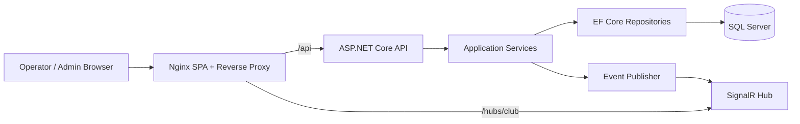

# PlayDesk architecture

## Runtime components

## Solution boundaries

- `Domain`: Customer, ClubTable, GameSession, Payment, ApplicationUser and AuditLog.
- `Application`: DTOs, interfaces, pricing, Baku time conversion, and business rules.
- `Infrastructure`: EF DbContext, mapping, repository, initial migration and seeding.
- `API`: controllers, cookie login, CSRF, role authorization, rate limiting, SignalR and API configuration.
- `frontend`: React SPA, TanStack Query server-state cache, real-time invalidation and UI.

## Concurrency & consistency

1. Creating a session first checks availability, then inserts a `GameSession` row. The **filtered unique index** on `ClubTableId` where `ClosedAtUtc IS NULL` guarantees a maximum of one active session for each table even if two requests race. A database uniqueness violation is returned as HTTP 409.
2. Charging a session updates its `ClosedAtUtc`, inserts `Payment`, and inserts `AuditLog` in **one EF Core SaveChanges**. EF Core uses a transaction to commit or roll back all operations. The unique index on `Payment.GameSessionId` and rowversion concurrency token protect against duplicate charges.
3. Each session holds the hourly rate snapshot and expected price. Prices do not drift when an administrator updates a table rate.
4. SQL Server `datetime2` loses the `DateTimeKind` flag; an API JSON converter guarantees a UTC `Z` suffix for timestamps, preventing browser-local timer drift. Each payment stores `PaidAtUtc` and `LocalPaymentDate`. Local date is computed using `Asia/Baku` on receipt, then indexed for efficient daily aggregation.
5. SignalR events are emitted after DB commit. If an event cannot be delivered, clients eventually reconcile through focus refetch and 60-second polling of important data. No event guarantees delivery.

## Identity and security

- This reference implementation uses ASP.NET Core cookie authentication, an HttpOnly session cookie, `PasswordHasher<ApplicationUser>` and role authorization. **It does not use full ASP.NET Core Identity** (registration, reset, lockout, email confirmation). For Internet-facing deployment, migrate account management to ASP.NET Core Identity or a trusted OIDC provider.
- All unsafe MVC controller actions require antiforgery tokens, obtained from `/api/auth/csrf`.
- Logins are rate-limited per remote address. A production proxy should configure trusted forwarded headers and additional upstream rate limiting.
- Default credentials are not hardcoded. Seed passwords must be set by environment variables or user secrets, and database credentials must not be committed.
- In Docker demo mode the API uses `ASPNETCORE_ENVIRONMENT=Development` for Scalar and local HTTP. **Do not expose demo settings or port bindings publicly**. Production requires TLS, hardened cookie settings, secret storage, security headers and a separate controlled migration step.

## Scaling notes / known limitations

- A single SQL Server database and a monolith are sufficient for an initial club deployment.
- Table deactivation and session creation are not serialized against each other in this edition. Both operations recheck state, but a narrow race exists around concurrent maintenance changes. Introduce a single SQL transaction and table-row lock for both operations before using maintenance controls with many simultaneous operators.
- No external payment provider is called. `Card` means the POS payment was already collected by the operator and is being recorded manually.
- No cancellation, refund, extension, reservations, or multi-tenant capability in v1.
- Audit records and revenue reporting are not a substitute for financial reconciliation, accounting, cash registers, tax compliance or immutable ledger functionality.
- The project includes unit tests; real SQL Server integration and Playwright E2E tests should be added prior to live use. See `docs/TESTING.md`.
